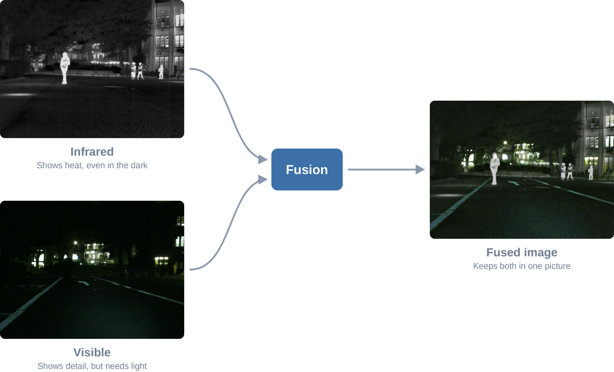

# Infrared-Visible Image Fusion Research (PFE)

Research on combining thermal and visible images into one more informative image.

  

Source images: [MSRS dataset](https://github.com/Linfeng-Tang/MSRS) (Tang et al., 2022).

## The problem

A car that drives itself relies on its cameras, and at night they see very little. In the visible image above, four pedestrians are in the scene and none of them can be seen. If the car cannot see them, it cannot segment the scene, which means labelling what is road, what is a person and what is another car. Without that, it cannot navigate safely.

An infrared camera helps, because it senses heat instead of light, so people stand out even in the dark. But it has its own blind spots: the lane markings in the visible image are missing from the infrared one, and a car needs those too.

Image fusion combines both into one image, so the people from the infrared camera and the road from the visible camera appear together.

## The research question

Many published fusion methods exist, each with its own strengths. This research asks how far those strengths can be brought together.

## How the work is measured

- **Image quality:** how much useful information and structure the fused image keeps from its two sources.
- **Usefulness:** how well vision tasks such as segmentation and detection perform on the fused images.

A fused image can look good to a person and still help a machine very little, so the work measures both.

## Status

This began as a final-year engineering project (PFE) at ENSA El Jadida, defended in September 2026, and the work has continued since. Methods, results and code are not public at this stage.

## Author

Abdullah Aljabri, ENSA El Jadida

## Supervisors

- Pr. Abdelfettah HAIDINE (Academic Supervisor)
- Pr. Ibrahim KAJO (Research Supervisor)
